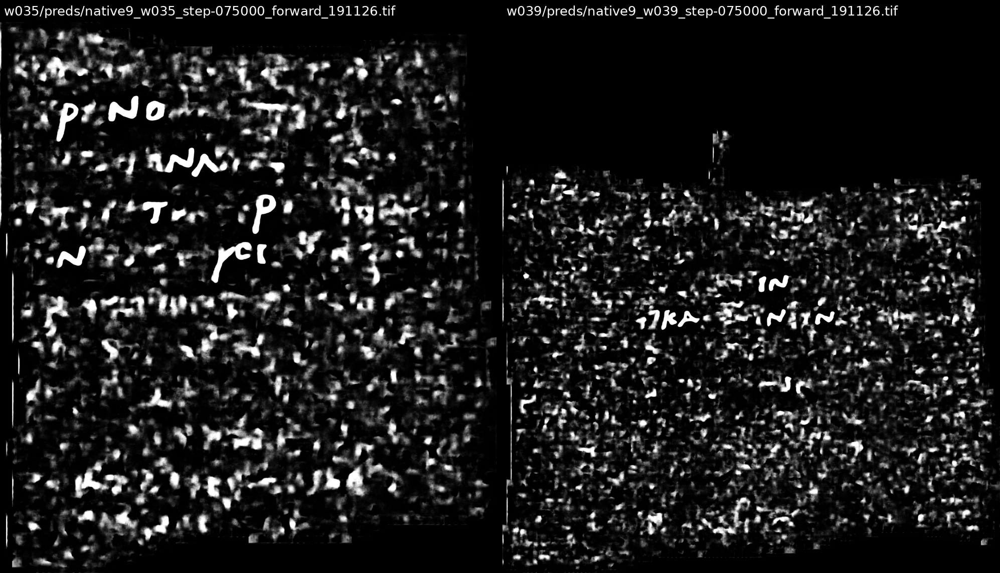

# Folder-mode ink inference on the ink_9um label layout: before/after evidence

Evidence for the fix on branch `fix/ink-folder-mode-label-zarrs`. Nothing here is part of that PR.

## Data

Two native 9.362 µm PHerc. 0139 segments of the `ink_9um` dataset, `w035` and `w039`, in
`ink_9um/labels/native9-scrollprizeorg-21slices/`, laid out as `vesuvius/docs/ink_detection.md` describes:

```text
native9-scrollprizeorg-21slices/
├── w035/
│   ├── w035_inklabels.zarr
│   ├── w035_supervision_mask.zarr
│   └── surface-volume.zarr
└── w039/
    ├── w039_inklabels.zarr
    ├── w039_supervision_mask.zarr
    └── surface-volume.zarr
```

- Labels: `hf buckets sync` from `hf://buckets/scrollprize/datasets/ink_9um`.
- `w035/surface-volume.zarr`: rendered on this laptop with the Tutorial 5 command (`vc_render_tifxyz`, 28 slices,
  `--flip-normals`, `--cache-gb 3`) from the published mesh `20260317000000-w035_2026031718` and the 9.362 µm volume
  `20250728140407`. 5240 × 5820 px.
- `w039/surface-volume.zarr`: the published
  `PHerc0139/segments/20260302000000-w039_2026030210/surface-volumes/9.362um-1.2m-113keV-volume-20250728140407.zarr`,
  downloaded with `scripts/fetch_native9.sh`. 7720 × 8560 px.
- Checkpoint: `scrollprize/ink_9um`, `hybrid_3d2d-seed42/step-075000.pth`.

## Runs

`scripts/folder_infer.sh` runs the folder command of `vesuvius/docs/ink_detection.md` with `--batch-size 16`.
RTX 2060 6 GB, Ubuntu 24.04 under WSL2.

| Code | `--folder` | Result | Log |
|---|---|---|---|
| main `0bddf2757` | the label folder | `segments_ran=0 segments_skipped=2`, no TIFF, exit code 0 | `logs/before_parent_folder.log` |
| this branch `7c9984919` | the label folder | `segments_ran=2 segments_skipped=0`, 217 s | `logs/after_parent_folder.log` |
| main `0bddf2757` | `w039` alone | `segments_ran=0 segments_skipped=3`: each of its three Zarrs is taken for a segment | `logs/before_segment_folder.log` |
| this branch `7c9984919` | `w039` alone | `segments_ran=1 segments_skipped=0`, 94 s | `logs/after_segment_folder.log` |

## Predictions

The two TIFFs the folder run wrote, stretched for viewing as Tutorial 5 suggests (`(p - 0.25) / 0.5`):



Both segments are in this checkpoint's training set, so the labelled letters are expected to show.

`logs/predictions.txt` (written by `scripts/evidence.py`): the w035 prediction of the folder run against the
prediction the same checkpoint gave for the same surface volume in single mode four days earlier. 633,306 of
30,496,800 pixels differ, each by 1/255, which is the run-to-run noise of this GPU.

## Tests

`logs/tests.txt` (written by `scripts/tests.sh`): the new regression test fails with main's inference code and
passes on this branch; `tests/ink_detection` passes on this branch.
